<h1 align="center">
   Odontra
</h1>

<p align="center">
  
  
  
  
  
  
</p>

<p align="center">
  <strong>Seu painel odontológico, na palma da mão.</strong><br/>
  Cadastre pacientes com foto, marque os dentes com um toque, organize a agenda e gere o prontuário em PDF pronto para imprimir.<br/>
  <a href="https://odontra.vercel.app"><strong>odontra.vercel.app</strong></a>
</p>

<p align="center">
  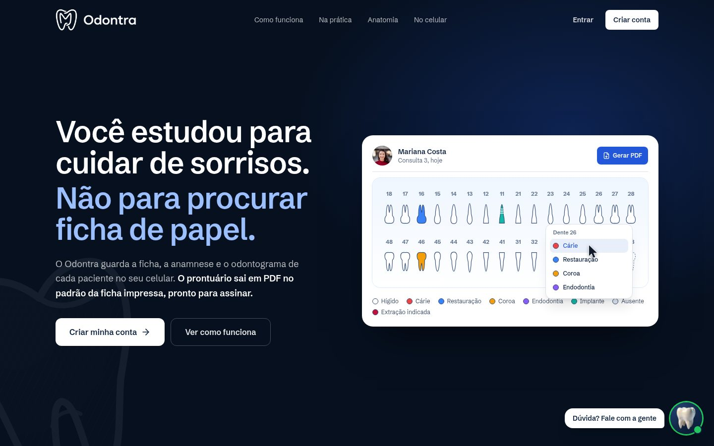
</p>

## Recursos

<table>
<tr>
<td width="46%" valign="middle">

### Odontograma de toque

Os 32 dentes na tela, coloridos por condição: cárie, restauração, coroa, endodontia, implante, ausente e extração indicada. Toque no dente, escolha a condição e escreva uma observação.

</td>
<td width="54%" align="center">
  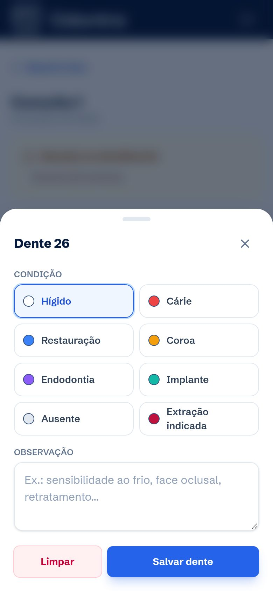
</td>
</tr>
<tr>
<td width="46%" valign="middle">

### Paciente com histórico

Ficha com foto (câmera ou galeria), identificação e anamnese completa. Cada consulta vira uma evolução clínica, e a próxima já parte do odontograma anterior. Alergia, gestação e medicação aparecem em destaque antes do atendimento.

</td>
<td width="54%" align="center">
  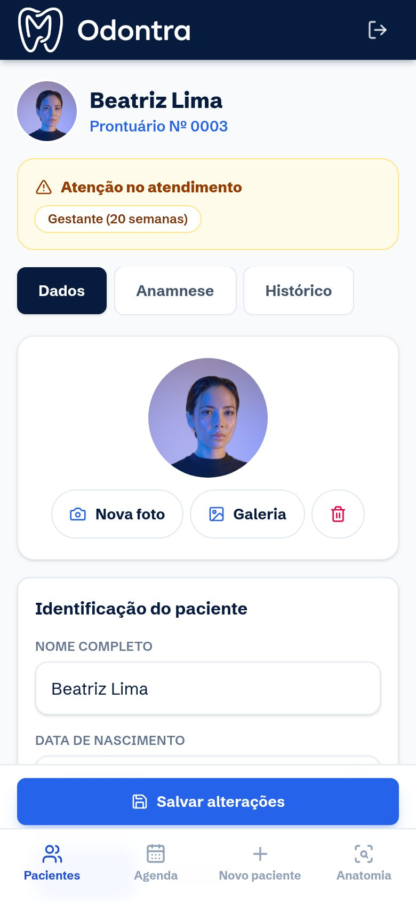
</td>
</tr>
<tr>
<td width="46%" valign="middle">

### Anatomia do dente interativa

Toque no esmalte, na dentina, na polpa, no cemento, na gengiva e no osso para ver o que cada parte faz. Ligue e desligue camadas, revele o interior e use o tour automático para explicar o tratamento ao paciente.

</td>
<td width="54%" align="center">
  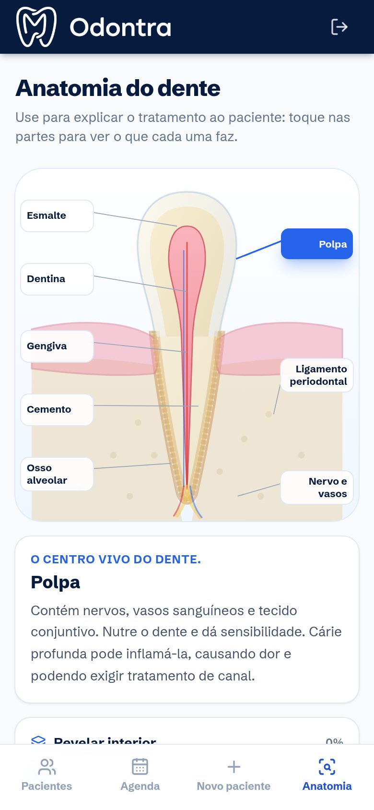
</td>
</tr>
<tr>
<td width="46%" valign="middle">

### PDF e impressão em um toque

Prontuário em A4 no modelo clássico: identificação, anamnese, saúde bucal, exame clínico, odontograma colorido, procedimentos, assinatura e QR code do sistema no rodapé.

</td>
<td width="54%" align="center">
  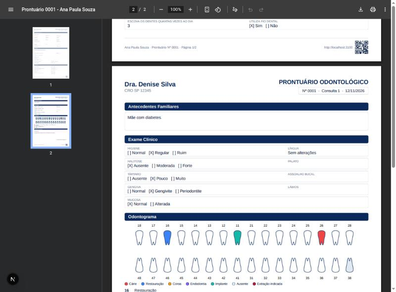
</td>
</tr>
<tr>
<td width="46%" valign="middle">

### Agenda no estilo do iPhone

Mês com título grande, hoje em destaque e os horários em etiquetas coloridas dentro de cada dia, como no Calendário do iOS. No iPad, mês e dia lado a lado. Cada horário vai para o Google Agenda com um toque.

</td>
<td width="54%" align="center">
  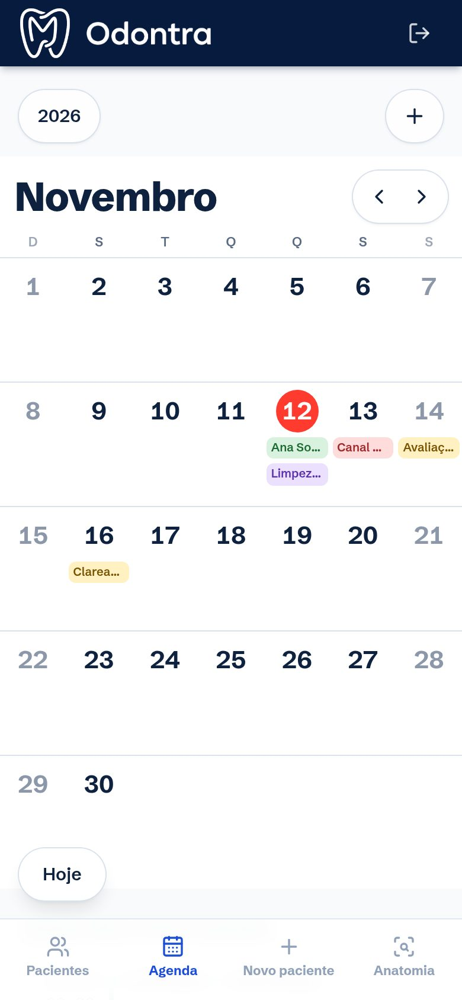
</td>
</tr>
<tr>
<td width="46%" valign="middle">

### A ficha de papel, na tela

Os mesmos campos da ficha clínica impressa, com odontograma em tinta vermelha, arco com radiografias e anotações em letra de mão. Aparece na consulta (aba **Ficha**) e de forma interativa na landing.

</td>
<td width="54%" align="center">
  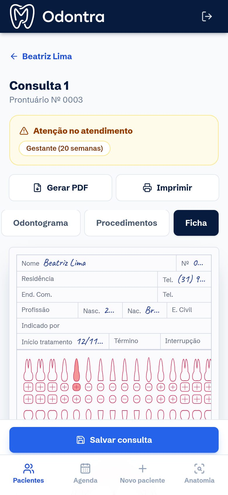
</td>
</tr>
</table>

- **Feito para iPhone, iPad e Android:** barra inferior no alcance do polegar, botões grandes, editor de dente em painel deslizante e rolagem nativa. Instalável na tela inicial (o app avisa uma vez como fazer).
- **Conta e segurança:** login com e-mail e senha (Supabase Auth), senha forte, cadastro que já entra no painel, recuperação de senha por e-mail e e-mail de boas-vindas. Nenhuma tela fica presa em "Aguarde…": toda ação tem tempo limite e mensagem clara.
- **Dados de cada dentista isolados:** Postgres com RLS em todas as tabelas; um dentista nunca vê pacientes, consultas ou agenda de outro. Numeração do prontuário e da consulta feita pelo banco, sem duplicar.
- **Erros visíveis:** se salvar falhar, o aviso aparece e o que foi digitado continua na tela.
- **Landing:** primeira tela com demonstração guiada por cursor, fotos reais de clínica, ficha interativa, dente 3D no login e atalho para tirar dúvidas no WhatsApp.

<p align="center">
  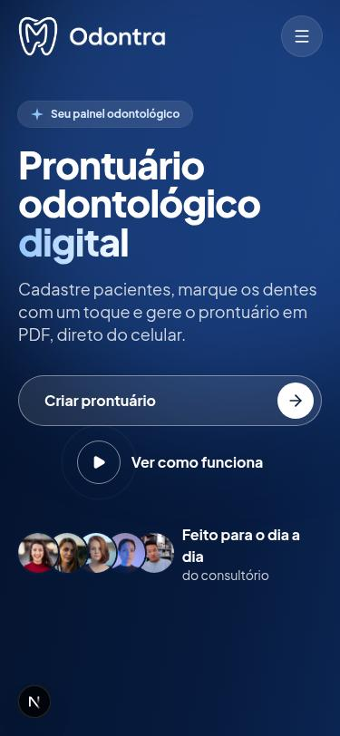
  &nbsp;
  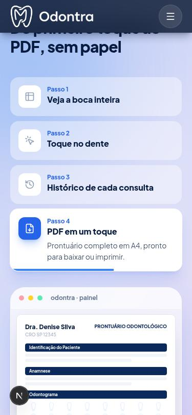
  &nbsp;
  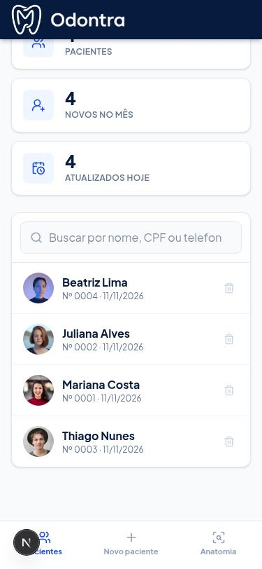
</p>

<p align="center">
  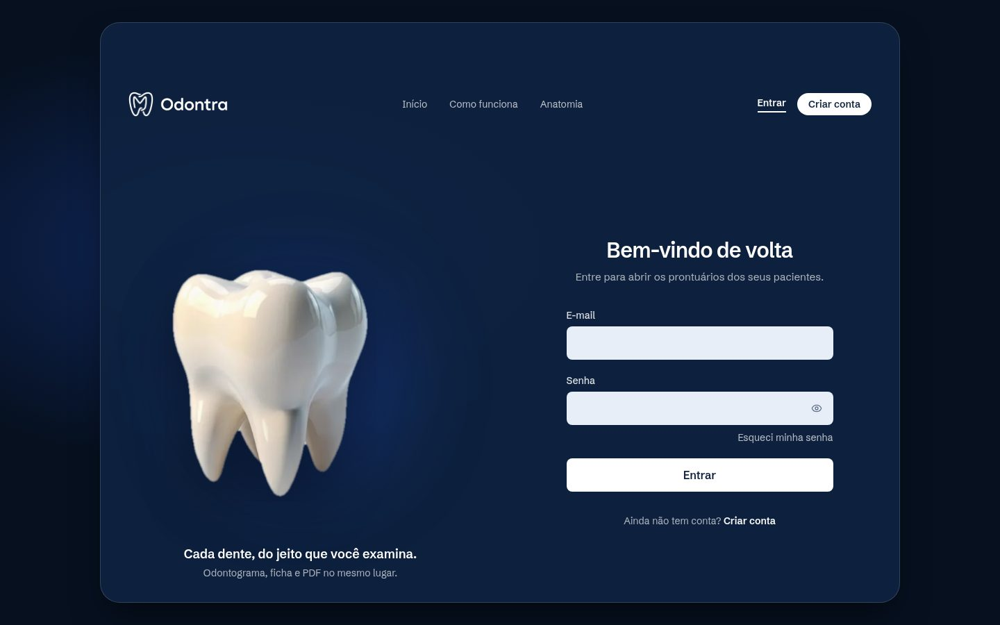
</p>

## Como rodar

Requer **Node.js 24** e **Docker** (para o banco local).

```bash
git clone https://github.com/dutrathiagodev/Odontra.git
cd Odontra
npm install
npm run db:start      # Supabase local no Docker
cp .env.example .env.local   # preencha com o que `npm run db:status` mostrar
npm run dev
```

Abra `http://localhost:3000` e entre com a conta de teste local `dentista@odontra.test` / `Odontra12345` (só existe no banco local). Passo a passo completo em [docs/desenvolvimento-local.md](docs/desenvolvimento-local.md).

| Comando | O que faz |
|---------|-----------|
| `npm run dev` | Servidor de desenvolvimento |
| `npm run build` / `npm start` | Build e servidor de produção |
| `npm run lint` | ESLint |
| `npm run typecheck` | Tipos do Next + TypeScript |
| `npm test` | Testes unitários (Vitest) |
| `npm run db:reset` | Recria o banco local do zero (migrations + dados de teste) |
| `npm run db:test` | Testes de segurança do banco (RLS, pgTAP) |

<details>
<summary>Variáveis de ambiente</summary>

| Variável | Onde | Para que serve |
|----------|------|----------------|
| `NEXT_PUBLIC_SUPABASE_URL` | navegador | Endereço do projeto Supabase |
| `NEXT_PUBLIC_SUPABASE_PUBLISHABLE_KEY` | navegador | Chave publicável (a proteção dos dados é a RLS) |
| `NEXT_PUBLIC_SITE_URL` | navegador | Endereço público: QR code, links dos e-mails |
| `RESEND_API_KEY` | só servidor | Envio do e-mail de boas-vindas |
| `EMAIL_FROM` | só servidor | Remetente dos e-mails |

Em produção, sem as variáveis do Supabase o painel não abre (nunca grava dados de paciente no navegador).

</details>

## Arquitetura

Clean Architecture, com a regra de dependência sempre apontando para dentro:

```
app (rotas) ─► presentation ─► application ─► domain
                    │                ▲
                    └─► infrastructure ┘
```

| Pasta | O que tem |
|-------|-----------|
| `domain/` | Entidades (`Patient`, `Visit`, `Appointment`, `Odontogram`), fábricas, opções clínicas e contratos de repositório. TypeScript puro. |
| `application/` | Casos de uso, um por arquivo, com método `execute`. |
| `infrastructure/` | Repositórios Supabase (e `localStorage` só em desenvolvimento), cliente Supabase, e-mail e o composition root `container.ts`. |
| `presentation/` | Componentes React: painel, agenda, odontograma, ficha de papel, anatomia, PDF, landing e hooks (`useRecordEditor`, `useAsync`). |
| `app/` | Rotas do Next.js 16 (App Router), a tela `/auth/confirm` (link do e-mail validado só no clique do botão) e a rota de API `/api/boas-vindas`. |
| `supabase/` | Migrations, testes pgTAP, dados de teste locais e templates de e-mail. |

Detalhes em [docs/architecture](docs/architecture/README.md).

## Fluxo de trabalho

Git Flow: `main` é produção, `develop` é integração. Cada tarefa sai de `develop` numa branch `Odontra/<card>-descricao`, vira PR para `develop` e, na entrega, um PR de `develop` para `main`. Os PRs passam por lint, tipos, testes e build, e não aceitam commits com coautor de ferramenta. Tarefas no Trello com o número `Odontra/000NN`. Guia em [docs/git-flow.md](docs/git-flow.md).

## Roadmap

- Entrar com Google e sincronização automática com o Google Agenda.
- Acesso do paciente (convite, portal só de leitura, LGPD).
- Domínio próprio e e-mails pelo domínio.
- Exames e imagens do paciente, assinatura eletrônica e orçamentos.

## Créditos

Desenvolvido por **Risemov** ([dutrathiagodev](https://github.com/dutrathiagodev)). Fotos: [Unsplash](https://unsplash.com).
